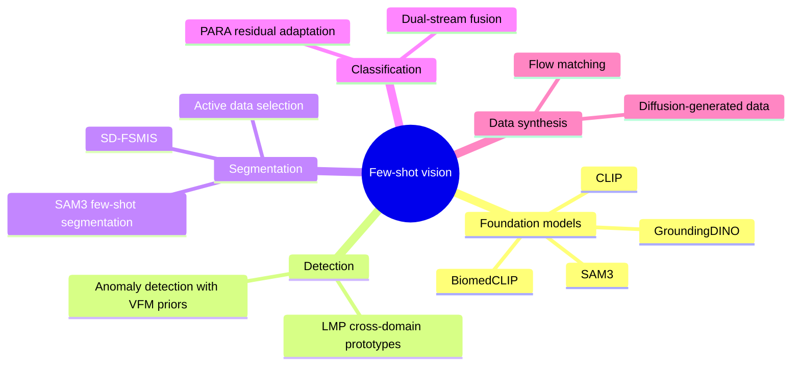

<div align="center">

# 🔬 Research

### Few-shot learning for vision: reading list, notes and runnable paper reproductions

<sub>Building toward few-shot <b>defect detection</b> for Bangladesh's ready-made garment (RMG) industry, where labelled defect images are scarce.</sub>

<br/>

[](#-reading-list)
[](#-notebooks)
[](#-notebooks)

[](https://github.com/KaziBadrul/Research/commits/main)
[](https://github.com/KaziBadrul/Research/pulse)
[](https://github.com/KaziBadrul/Research)
[](https://github.com/KaziBadrul/Research)
[](https://github.com/KaziBadrul/Research/actions/workflows/update-readme.yml)

</div>

<!-- AUTO:STATS:START -->
> 📚 **11** papers &nbsp;·&nbsp; 🧪 **4** notebooks &nbsp;·&nbsp; 🗂️ **3** paper reproductions &nbsp;·&nbsp; 🔄 index rebuilt **2026-11-09**
<!-- AUTO:STATS:END -->

---

## 🧭 Contents

- [Research focus](#-research-focus)
- [Notebooks](#-notebooks)
- [Paper reproductions](#-paper-reproductions)
- [Reading list](#-reading-list)
- [Getting started](#-getting-started)
- [Repository layout](#-repository-layout)
- [How this README stays up to date](#-how-this-readme-stays-up-to-date)

---

## 🎯 Research focus

Real-world defect datasets are tiny, imbalanced and visually different from the web images most models are trained on. This repo collects the methods that try to work in exactly that regime: **learning a new class from 1 to 10 examples, often in an unfamiliar visual domain.**



**Questions I'm exploring**

1. Can **visual prototypes** (as in LMP) fix what text prompts can't describe, like a skipped stitch or an oil stain on fabric?
2. How far do frozen **vision-language models** get with lightweight adapters (LoRA, residual adaptation) and only a few labelled images?
3. Does **synthetic data** from diffusion or flow models actually help when real defects are rare?
4. Which support examples are worth labelling? (**active few-shot** selection)

---

## 🧪 Notebooks

Every notebook is self-contained and runs on a free **Colab T4**. Click the badge to open it directly.

<!-- AUTO:NOTEBOOKS:START -->
| Notebook | What it does | Stack | Run |
|---|---|---|:---:|
| [**CLIP Playground**](CLIP/clip_playground.ipynb)<br/><sub>`CLIP/clip_playground.ipynb`</sub> | Zero-shot classification with prompt ensembling, image-text similarity, CIFAR-10 benchmark, few-shot linear probe (1 to 16 shots) and running it all on your own dataset. | OpenAI CLIP · 🤗 Transformers · scikit-learn | [](https://colab.research.google.com/github/KaziBadrul/Research/blob/main/CLIP/clip_playground.ipynb)<br/><sub>[nbviewer](https://nbviewer.org/github/KaziBadrul/Research/blob/main/CLIP/clip_playground.ipynb)</sub> |
| [**LMP on 🤗 GroundingDINO**](LMP_2602.18811/Implementation_LMP.ipynb)<br/><sub>`LMP_2602.18811/Implementation_LMP.ipynb`</sub> | Dual-branch LMP built on Hugging Face GroundingDINO, with a C-way K-shot sampler, Hungarian matcher (Focal + L1 + GIoU) and a 5-shot run on the NEU-DET steel defect dataset. | PyTorch · 🤗 Transformers · NEU-DET | [](https://colab.research.google.com/github/KaziBadrul/Research/blob/main/LMP_2602.18811/Implementation_LMP.ipynb)<br/><sub>[nbviewer](https://nbviewer.org/github/KaziBadrul/Research/blob/main/LMP_2602.18811/Implementation_LMP.ipynb)</sub> |
| [**LMP: Full Reproduction & Self-Test**](LMP_2602.18811/LMP_CD_FSOD.ipynb)<br/><sub>`LMP_2602.18811/LMP_CD_FSOD.ipynb`</sub> | End-to-end reproduction of LMP: visual + hard-negative prototypes, dual-branch detector, two-stage training, live mAP vs. the paper's Table 1, t-SNE, qualitative results and ablations. | PyTorch · GroundingDINO | [](https://colab.research.google.com/github/KaziBadrul/Research/blob/main/LMP_2602.18811/LMP_CD_FSOD.ipynb)<br/><sub>[nbviewer](https://nbviewer.org/github/KaziBadrul/Research/blob/main/LMP_2602.18811/LMP_CD_FSOD.ipynb)</sub> |
| [**PARA: Prompt-Anchored Residual Adaptation**](PARA/PARA.ipynb)<br/><sub>`PARA/PARA.ipynb`</sub> | Beginner-annotated implementation of PARA on BiomedCLIP with LoRA adapters, evaluated few-shot on DermaMNIST (or your own image folder). | BiomedCLIP · open_clip · MedMNIST | [](https://colab.research.google.com/github/KaziBadrul/Research/blob/main/PARA/PARA.ipynb)<br/><sub>[nbviewer](https://nbviewer.org/github/KaziBadrul/Research/blob/main/PARA/PARA.ipynb)</sub> |
<!-- AUTO:NOTEBOOKS:END -->

---

## 🧩 Paper reproductions

<details open>
<summary><b>LMP: Learning Multi-Modal Prototypes for Cross-Domain Few-Shot Object Detection</b> &nbsp;<code>LMP_2602.18811/</code></summary>
<br/>

Text prompts know *what* an object is, but not *how it looks* in a new domain. LMP adds a **visual branch** to GroundingDINO, fed by class prototypes from the support images plus **hard-negative prototypes** made by jittering ground-truth boxes, then ensembles it with the original text branch.

```
Support images (K-shot)  ─►  class prototypes  ─┐
                                                ├─►  visual-guided branch ─┐
Query GT boxes (jitter)  ─►  hard negatives    ─┘                          ├─►  ensemble ─►  detections
Class names              ─────────────────────────►  text-guided branch  ─┘
```

- 📓 [`LMP_CD_FSOD.ipynb`](LMP_2602.18811/LMP_CD_FSOD.ipynb): full reproduction with live mAP, t-SNE and ablations
- 📓 [`Implementation_LMP.ipynb`](LMP_2602.18811/Implementation_LMP.ipynb): Hugging Face GroundingDINO version, tested on **NEU-DET steel defects**
- 📝 [`notes.md`](LMP_2602.18811/notes.md): plain-language notes on the method, mAP and box jittering
- 📄 [Paper (arXiv 2602.18811)](https://arxiv.org/abs/2602.18811)

</details>

<details>
<summary><b>PARA: Prompt-Anchored Residual Adaptation for Biomedical VLMs</b> &nbsp;<code>PARA/</code></summary>
<br/>

Keeps BiomedCLIP's zero-shot **prompt prediction** as an anchor and learns only a small **residual** on top with LoRA, so a handful of unlucky support images can't drag the model too far. No official code was released, so the notebook follows the paper's equations, with every line commented.

- 📓 [`PARA.ipynb`](PARA/PARA.ipynb): BiomedCLIP + LoRA on DermaMNIST, with repeated support draws
- 📄 [Paper (arXiv 2609.33701)](https://arxiv.org/abs/2609.33701)

</details>

<details>
<summary><b>CLIP baseline playground</b> &nbsp;<code>CLIP/</code></summary>
<br/>

The reference point for everything else: zero-shot vs. few-shot linear probe on CIFAR-10, plus a "bring your own folder" mode for quick tests on custom data (try labels like `"a torn seam on a shirt"` vs `"a clean seam on a shirt"`).

- 📓 [`clip_playground.ipynb`](CLIP/clip_playground.ipynb)
- 📄 [Paper (arXiv 2103.00020)](https://arxiv.org/abs/2103.00020)

</details>

<details>
<summary><b>SAM3 for few-shot semantic segmentation</b> &nbsp;<code>SAM3_2604.05433/</code> &nbsp;<sub>🚧 reading</sub></summary>
<br/>

- 📄 [Paper (arXiv 2604.05433)](https://arxiv.org/abs/2604.05433), notebook coming next

</details>

---

## 📚 Reading list

Sorted newest first. Rows with **🧪 Code** link to a reproduction in this repo.

<!-- AUTO:PAPERS:START -->
| Date | Paper | Topic | Links |
|:---:|---|---|---|
| 2026-09 | **Bridging Vision Foundation Model Priors with CLIP for Spatial-aware Few-shot Anomaly Detection in Medical Images**<br/><sub>Miao et al.</sub> | Few-shot anomaly detection | [📄 PDF](2609.12454v1.pdf) · [arXiv](https://arxiv.org/abs/2609.12454) |
| 2026-09 | **Prompt-Anchored Residual Adaptation for Biomedical Vision-Language Models (PARA)**<br/><sub>Kang et al.</sub> | VLM adaptation · Classification | [📄 PDF](PARA/Prompt-Anchored%20Residual%20Adaptation.pdf) · [arXiv](https://arxiv.org/abs/2609.33701) · [🧪 Code](PARA) |
| 2026-07 | **Neuron-Aware Active Few-Shot Learning for LLMs**<br/><sub>Chen et al.</sub> | Active learning · LLMs | [📄 PDF](2607.02423v1.pdf) · [arXiv](https://arxiv.org/abs/2607.02423) |
| 2026-07 | **Active Few-Shot Segmentation by Reinforcing Data Selection**<br/><sub>Zhao et al.</sub> | Active learning · Segmentation | [📄 PDF](2607.22371v1.pdf) · [arXiv](https://arxiv.org/abs/2607.22371) |
| 2026-05 | **Few-Shot Synthetic Data Generation with Diffusion Models for Downstream Vision Tasks**<br/><sub>Dushenev et al.</sub> | Data synthesis | [📄 PDF](2605.11898v1.pdf) · [arXiv](https://arxiv.org/abs/2605.11898) |
| 2026-04 | **Few-Shot Distribution-Aligned Flow Matching for Data Synthesis in Medical Image Segmentation**<br/><sub>Yang et al.</sub> | Data synthesis · Segmentation | [📄 PDF](2604.02868v1.pdf) · [arXiv](https://arxiv.org/abs/2604.02868) |
| 2026-04 | **SD-FSMIS: Adapting Stable Diffusion for Few-Shot Medical Image Segmentation**<br/><sub>Li et al.</sub> | Few-shot segmentation | [📄 PDF](2604.03134v2.pdf) · [arXiv](https://arxiv.org/abs/2604.03134) |
| 2026-04 | **Few-Shot Semantic Segmentation Meets SAM3**<br/><sub>Tsai et al.</sub> | Few-shot segmentation | [📄 PDF](SAM3_2604.05433/2604.05433v1.pdf) · [arXiv](https://arxiv.org/abs/2604.05433) |
| 2026-02 | **Learning Multi-Modal Prototypes for Cross-Domain Few-Shot Object Detection (LMP)**<br/><sub>Wang et al. · CVPR 2026</sub> | Few-shot detection | [📄 PDF](LMP_2602.18811/2602.18811v1.pdf) · [arXiv](https://arxiv.org/abs/2602.18811) · [🧪 Code](LMP_2602.18811) |
| 2026 | **Prior-Knowledge-Guided Dual-Stream Fusion Network for Few-Shot Medical Image Classification**<br/><sub>Huang et al. · IET Image Processing</sub> | Few-shot classification | [📄 PDF](IET%20Image%20Processing%20-%202026%20-%20Huang%20-%20Prior%E2%80%90Knowledge%E2%80%90Guided%20Dual%E2%80%90Stream%20Fusion%20Network%20for%20Few%E2%80%90Shot%20Medical%20Image.pdf) |
| 2021-03 | **Learning Transferable Visual Models From Natural Language Supervision (CLIP)**<br/><sub>Radford et al.</sub> | Vision-language pretraining | [📄 PDF](2103.00020v1.pdf) · [arXiv](https://arxiv.org/abs/2103.00020) · [🧪 Code](CLIP) |
<!-- AUTO:PAPERS:END -->

---

## 🚀 Getting started

**Fastest:** click any **Open in Colab** badge above, then `Runtime > Change runtime type > T4 GPU` and run all cells.

**Locally:**

```bash
git clone https://github.com/KaziBadrul/Research.git
cd Research
python -m venv .venv && source .venv/bin/activate   # Windows: .venv\Scripts\activate
pip install torch torchvision transformers open_clip_torch medmnist scikit-learn pycocotools jupyter
jupyter lab
```

> 💡 A CUDA GPU with 16 GB+ VRAM is recommended for the LMP notebooks. The CLIP and PARA notebooks run fine on a T4.

---

## 🗂️ Repository layout

```
Research/
├── CLIP/                     # CLIP zero-shot & few-shot playground
├── LMP_2602.18811/           # LMP reproduction: notebooks, notes, paper
├── PARA/                     # PARA reproduction on BiomedCLIP
├── SAM3_2604.05433/          # SAM3 few-shot segmentation (in progress)
├── *.pdf                     # Reading list papers
├── scripts/update_readme.py  # Rebuilds the auto sections of this README
└── .github/
    ├── readme-meta.json      # Paper titles, topics and notebook blurbs
    ├── badges/               # Live counter badges (generated)
    └── workflows/update-readme.yml
```

Folders are named `<METHOD>_<arXiv id>` when they reproduce a specific paper.

---

## ⚙️ How this README stays up to date

The **stats line**, **Notebooks** table, **Reading list** and the **paper/notebook counter badges** are generated, not hand-written.

1. On every push that adds or changes a `.pdf`, `.ipynb` or `readme-meta.json`, the [`update-readme`](.github/workflows/update-readme.yml) workflow runs (it also runs weekly and can be triggered manually).
2. [`scripts/update_readme.py`](scripts/update_readme.py) scans the repo, looks up any new arXiv PDF's title on the arXiv API, and rewrites the blocks between the `<!-- AUTO:... -->` markers.
3. Changes are committed back automatically.

**To add a paper:** drop the PDF in (keep the arXiv ID in the filename, e.g. `2611.01234v1.pdf`) and push. Optionally add a `topic` for it in `.github/readme-meta.json`.<br/>
**To add a notebook:** start it with a `# Title` markdown cell, or describe it in `readme-meta.json`.

Run it locally with `python scripts/update_readme.py`.

---

<div align="center">

<sub>Maintained by <a href="https://github.com/KaziBadrul">Kazi Badrul Hasan</a> · CSE, Islamic University of Technology</sub><br/>
<sub>Papers belong to their respective authors and are linked here for study.</sub>

</div>
